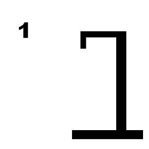

# Git-master

# Galgje – Git Collaboration

**Team:** <IDK>  
**Spelvolgorde & contact:**
1. <Ejuwaldi> – <42060@ma-web.nl>
2. <Anthony> – <41887@ma-web.nl>

---

## Woordraster
<!-- Pas het aantal kolommen aan aan de woordlengte -->
| . | . | . | . | . | . | . | . | . | . | . | . |
| - | - | - | - | - | - | - | - | - | - | - | - |
| 1 | 2 | 3 | 4 | 5 | 6 | 7 | 8 | 9 | 10 | 11 | 12 |

## Status

---

## Beurtenlog
- beurt1: <Ejuwaldi> gokt "?"
- (Git-master vult hier reactie in: goed/fout + updates)
- beurt2: ...